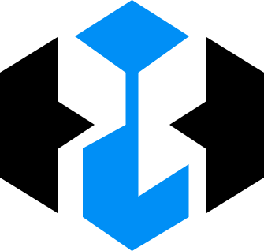
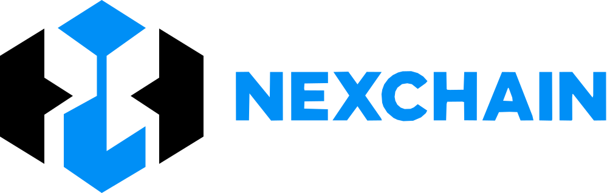

# NexChain identity kit

Vector assets for the NexChain mark, wordmark and lockups. Everything here is a
plain, dependency-free SVG — no fonts, no filters, no external references — plus
pre-rendered PNGs for the places that still need a bitmap.

Open `preview.html` to see the whole set on light and dark surfaces.

## Files

| File                    | Use                                    | Colour                | viewBox       |
| ----------------------- | -------------------------------------- | --------------------- | ------------- |
| `mark.svg`              | Emblem, tight bounding box             | ink + blue            | `0 0 335 318` |
| `mark-inverse.svg`      | Emblem on dark surfaces                | white + blue          | `0 0 335 318` |
| `mark-mono.svg`         | Emblem, any single colour              | `currentColor`        | `0 0 335 318` |
| `wordmark.svg`          | NEXCHAIN on its own                    | `currentColor`        | `0 0 611 83`  |
| `logo.svg`              | Horizontal lockup, light               | ink + blue            | `0 0 999 318` |
| `logo-inverse.svg`      | Horizontal lockup, dark                | white + blue          | `0 0 999 318` |
| `logo-mono.svg`         | Horizontal lockup, one colour          | `currentColor`        | `0 0 999 318` |
| `logo-stacked.svg`      | Square / vertical placements           | ink + blue            | `0 0 611 446` |
| `logo-stacked-inverse.svg` | Stacked lockup, dark                | white + blue          | `0 0 611 446` |
| `app-icon.svg`          | PWA + desktop icon                     | white + blue on black | `0 0 512 512` |
| `app-icon-maskable.svg` | Maskable icon with the 80% safe zone   | white + blue on black | `0 0 512 512` |
| `favicon.svg`           | Browser tab                            | white on blue         | `0 0 32 32`   |
| `favicon.ico`           | Legacy tab icon (16 / 32 / 48)         | white on blue         | —             |
| `png/`                  | 512, 192, 180, 48, 32, 16 + logo 1200  | —                     | —             |
| `tokens.css`            | Colour + ratio custom properties       | —                     | —             |

## Use it

Image tag (any framework):

```html


```

Inline, when the mark has to inherit colour (header, favicon-on-the-fly, canvas):

```html
<svg viewBox="0 0 335 318" role="img" aria-label="NexChain" fill="currentColor">
	<path d="M73 47L0 92L0 225L73 270L73 189L120 158L73 128Z" />
	<path d="M262 47L335 92L335 225L262 270L262 189L215 158L262 128Z" />
	<path d="M167.5 0L240 46L175.5 92L175.5 249L239.5 208L239.5 275L167.5 318L105 275L105 188L159.5 158L159.5 92L95 46Z" />
</svg>
```

The two-tone version is the same geometry with the first two paths `#000` (or
`#fff` on dark) and the third `#008FF6`.

Favicon wiring:

```html
<link rel="icon" href="/brand/favicon.svg" type="image/svg+xml" />
<link rel="alternate icon" href="/brand/png/favicon-32.png" sizes="32x32" />
<link rel="apple-touch-icon" href="/brand/png/apple-touch-icon-180.png" />
```

Colour tokens:

```css
@import url('brand/tokens.css');
/* --nx-blue: #008ff6; --nx-ink: #000; --nx-paper: #fff; */
```

## Rules

- **Clear space** — at least `0.25 × mark height` on every side. Nothing enters
  that band.
- **Minimum size** — mark `20px` tall, horizontal lockup `96px` wide. Below
  that, use the mark alone.
- **Colour** — brackets in ink or white, column in Nex Blue. Never recolour one
  without the other; for a single-colour context use the `-mono` variants.
- **Don't** add gradients, shadows, outlines, rotation, or re-space the
  wordmark. The lockup gap and cap height are fixed.
- **Backgrounds** — two-tone on white and light greys, `-inverse` on dark, mono
  in white over photography.

## Geometry

The mark is built on a 335 × 318 grid from the presentation sheet, with a single
diagonal ratio (~0.63) shared by every chamfer:

| Feature            | Value                                     |
| ------------------ | ----------------------------------------- |
| Mark box           | 335 × 318                                 |
| Bracket outer edge | `x = 0` / `x = 335`, vertical `y 92 → 225` |
| Bracket inner edge | `x = 73` / `x = 262`                      |
| Inward spike tip   | `x = 120` / `x = 215`, `y = 158` (centre)  |
| Column width       | 16 (`x 159.5 → 175.5`)                    |
| Diamond corners    | `y = 46`, `x 95 → 240`                    |
| Column foot        | `x 105 → 239.5`, bottom point at `y 318`  |

Lockup: mark `335` + gap `53` + wordmark `611` = `999`, cap height `83`
(0.261 × mark height), wordmark optically centred on the mark.

The wordmark is **outlined** — traced from the artwork at sub-pixel accuracy and
simplified to ~130 points, so no font has to be installed or licensed anywhere
it is used.

## Provenance

Reconstructed from `Lembar Presentasi Logo NexChain Minimalis`. The mark is
rebuilt as clean geometry rather than auto-traced: against the source artwork the
blue column matches at **0.955 IoU** and the ink brackets at **0.973 IoU**, with
the residual being antialiasing on the edges. The wordmark trace scores
**0.952 IoU** against the original pixels.

This kit replaces every earlier NexChain mark: the old `brand/nexchain-*.svg`
set, `brand/alternatives/`, and the explorations under `design/brand`,
`design/logo-concepts` and `design/nexchain-logo` have been removed.
